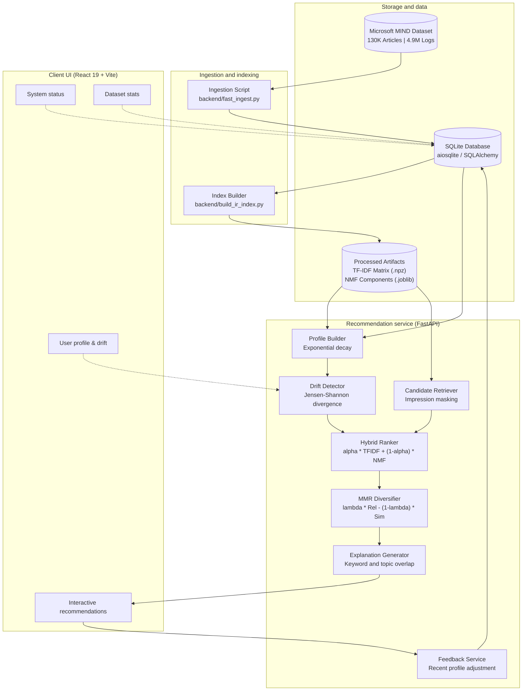

# Adaptive news discovery using interest drift and diversity-aware information retrieval

[](https://www.python.org/)
[](https://fastapi.tiangolo.com/)
[](https://react.dev/)
[](https://vitejs.dev/)
[](https://scikit-learn.org/)
[](https://sqlite.org/)
[](https://msnews.github.io)
[-success.svg)](#results-and-evaluation)
[](#license-and-dataset-terms)

Adaptive News Discovery is a news recommendation engine built on the Microsoft News Dataset (MIND). It combines sparse TF-IDF retrieval with 50-topic NMF distributions, models short- and long-term interest drift with exponential decay, and uses Maximal Marginal Relevance (MMR) to keep recommendation lists diverse. Everything runs on CPU with SQLite and Scikit-Learn, and includes a React 19 dashboard for inspecting profiles and testing live feedback.

## Table of contents

- [Overview](#overview)
- [Motivation](#motivation)
- [Key features](#key-features)
- [System architecture and workflow](#system-architecture-and-workflow)
- [Retrieval and recommendation methodology](#retrieval-and-recommendation-methodology)
- [Technologies used](#technologies-used)
- [Project directory structure](#project-directory-structure)
- [Dataset information and provenance](#dataset-information-and-provenance)
- [Installation and setup](#installation-and-setup)
- [Configuration and environment variables](#configuration-and-environment-variables)
- [How to run the project](#how-to-run-the-project)
- [Results and evaluation](#results-and-evaluation)
- [Experimental reports manifest](#experimental-reports-manifest)
- [API endpoints reference](#api-endpoints-reference)
- [Known limitations](#known-limitations)
- [Future roadmap](#future-roadmap)
- [License and dataset terms](#license-and-dataset-terms)
- [Contributing](#contributing)
- [Author and contact](#author-and-contact)

## Overview

News recommenders deal with two conflicting failure modes. Matching recent reading habits too closely produces repetitive feeds where five articles cover the exact same event. Leaning too heavily on site-wide popularity pushes viral stories that crowd out the specific topics a reader follows.

This project implements and evaluates a CPU-first hybrid pipeline to address both problems:
- Exact keyword vectors (TF-IDF) paired with latent topic distributions (50 NMF components).
- An exponential time decay separating long-term habits from short-term reading spikes.
- Jensen-Shannon Divergence tracking how quickly user interests change.
- Maximal Marginal Relevance (MMR) re-ranking to balance relevance against list redundancy.
- An interactive React 19 interface to inspect user profiles, test queries, and submit live feedback.

```text
[Historical Clicks] -> [Exponential Time Decay] -> [Long-Term and Recent Profiles]
                                                                |
[News Corpus] ------> [TF-IDF + 50 NMF Topics] ---> [Dual Vectors]
                                                          |     |
                                                          v     v
[Impression Slate] -> [Hybrid Ranking (alpha)] -> [MMR Diversity (lambda)] -> [Ranked Slate]
```

## Motivation

News reading habits differ from product purchasing or movie watching in a few specific ways:

- Readers follow long-running interests (like finance or local politics) alongside sudden short-term spikes (like breaking election results or a natural disaster). A single static profile blurs these short spikes into long-term history.
- Similar articles often cover the same story with slightly different phrasing, creating repetitive recommendation slates.
- Popularity bias increases click counts overall, but it regularly displaces niche categories that individual readers actually chose to follow.

We designed our benchmarks around three direct questions:
1. Does blending TF-IDF lexical matching with NMF topic distributions improve ranking accuracy over TF-IDF alone?
2. What accuracy penalty (NDCG@10) does Maximal Marginal Relevance introduce when increasing list diversity?
3. How much does mixing in overall article popularity degrade personalized recommendations?

## Key features

- Dual-representation indexing: 50,000-term TF-IDF sparse matrix paired with 50 latent topics from Non-negative Matrix Factorization (NMF).
- Temporal interest profiles: An exponential decay function ($\lambda_{\text{decay}}$) discounts older clicks to separate baseline reading habits from recent sessions.
- Drift measurement: Jensen-Shannon Divergence (JSD) between recent and long-term distributions classifies drift into stable, moderate, or significant states.
- MMR diversity re-ranking: Greedy Maximal Marginal Relevance balances relevance against inter-article similarity, measured by Intra-List Diversity (ILD).
- Popularity control: An interpolation parameter ($\beta$) balances personalized hybrid similarity against global article popularity.
- Transparent rationales: Each recommendation returns overlapping keywords, active topic labels, and whether it matched long-term or recent reading history.
- Live feedback updates: The API accepts `READ`, `LIKE`, and `DISLIKE` events, adjusting recent user weights in real time without modifying historical training logs.
- Offline evaluation pipeline: Evaluated across 93,612 users (141,171 impression sessions) on the MIND dev set with paired Wilcoxon signed-rank tests and Holm-Bonferroni corrections.
- Web dashboard: React 19 interface for checking system status, viewing dataset distributions, and testing recommendation parameters.

## System architecture and workflow

The system separates data storage, indexing, recommendation logic, and the web interface.



## Retrieval and recommendation methodology

### Article representation: TF-IDF and NMF topics

The indexer processes each headline and abstract (lowercasing, English stopwords, minimum document frequency of 2) into two complementary vectors:

1. Sparse lexical vector ($\mathbf{v}_a \in \mathbb{R}^{50,000}$): Built with Scikit-Learn's `TfidfVectorizer` using sublinear term-frequency scaling and smoothed inverse document frequency:
   $$\text{TF-IDF}(t, d) = \text{TF}(t, d) \times \left( \log \frac{1 + N}{1 + \text{DF}(t)} + 1 \right), \quad \text{normalized under } \ell_2 \text{ norm}$$
2. Dense topic vector ($\boldsymbol{\theta}_a \in \mathbb{R}^{50}$): Extracted by factorizing the article-term sparse matrix using Non-negative Matrix Factorization (NMF) with NNDSVD initialization:
   $$\min_{\mathbf{W} \ge 0, \mathbf{H} \ge 0} \frac{1}{2} \|\mathbf{V} - \mathbf{W}\mathbf{H}\|_F^2$$
   where $\mathbf{W} \in \mathbb{R}^{M \times 50}$ assigns articles to 50 latent topic dimensions.

### Temporal weighting and user profiling

A user profile aggregates the vectors of articles the user clicked previously, weighted by an exponential decay function to discount older interactions:

$$w_i = \exp(-\lambda_{\text{decay}} \cdot \Delta t_i)$$

where $\Delta t_i = (t_{\text{reference}} - t_i)$ is the age of the interaction in days.
- Long-term profile ($\mathbf{P}_{\text{long}}$): Aggregates historical clicks across all recorded training sessions.
- Recent profile ($\mathbf{P}_{\text{recent}}$): Isolates interactions from the most recent active window.
- Historical clicks in MIND that lack per-click timestamps use uniform baseline weighting ($w = 1.0$).

### Interest drift detection with Jensen-Shannon divergence

We compare a user's recent category distribution against their long-term history using Jensen-Shannon Divergence:

$$\text{JSD}(\mathbf{P} \parallel \mathbf{Q}) = \frac{1}{2} D_{\text{KL}}(\mathbf{P} \parallel \mathbf{M}) + \frac{1}{2} D_{\text{KL}}(\mathbf{Q} \parallel \mathbf{M}), \quad \mathbf{M} = \frac{1}{2}(\mathbf{P} + \mathbf{Q})$$

where $D_{\text{KL}}$ is Kullback-Leibler divergence with smoothing ($\epsilon = 10^{-9}$). Drift is grouped into three thresholds:
- $\text{JSD} \le 0.05$: Stable (Long-term profile receives higher weight)
- $0.05 < \text{JSD} \le 0.20$: Moderate (Balanced interpolation)
- $\text{JSD} > 0.20$: Significant (Recent profile receives higher weight)

### Hybrid retrieval scoring

For candidate article $a$ and user profile $u$, relevance combines lexical cosine similarity and topic cosine similarity through the parameter $\alpha \in [0, 1]$:

$$S_{\text{hybrid}}(u, a) = \alpha \cdot \cos(\mathbf{v}_u, \mathbf{v}_a) + (1 - \alpha) \cdot \cos(\boldsymbol{\theta}_u, \boldsymbol{\theta}_a)$$

When testing popularity bias, this score is interpolated with the article's normalized training-set click count $\text{Pop}(a) \in [0, 1]$ through $\beta \in [0, 1]$:

$$S_{\text{final}}(u, a) = \beta \cdot S_{\text{hybrid}}(u, a) + (1 - \beta) \cdot \text{Pop}(a)$$

### Diversity re-ranking with Maximal Marginal Relevance

To reduce repetitive recommendations, the system applies greedy Maximal Marginal Relevance (MMR) over the candidate pool:

$$\text{MMR}(u, C, S) = \arg\max_{a_i \in C \setminus S} \left[ \lambda_{\text{MMR}} \cdot S_{\text{final}}(u, a_i) - (1 - \lambda_{\text{MMR}}) \max_{a_j \in S} \text{Sim}(a_i, a_j) \right]$$

- $C$ is the initial candidate pool (50 to 100 articles).
- $S$ is the list of already selected articles.
- $\text{Sim}(a_i, a_j)$ is pairwise cosine similarity in TF-IDF space.
- List diversity is evaluated using Intra-List Diversity (ILD):
  $$\text{ILD}(S) = \frac{2}{|S|(|S| - 1)} \sum_{a_i \in S} \sum_{a_j \in S, j > i} \left(1 - \text{Sim}(a_i, a_j)\right)$$

### Explanations

Each recommended article includes a readable explanation showing:
- Intersecting lexical terms (for example, `["inflation", "federal reserve", "rates"]`).
- Dominant NMF topic index and top topic terms.
- Source profile attribution (whether the item matched long-term or recent reading history).
- Whether MMR promoted the article to improve diversity.

### Live user feedback updates

User actions update recent profile weights directly:
- `READ`: $+0.5$ applied to the article vector.
- `LIKE`: $+1.0$ applied to reinforce interest.
- `DISLIKE`: $-1.0$ applied to penalize matching features.

Events are logged to a dedicated feedback table and recalculate the dynamic recent profile without changing the historical MIND dataset records.

## Technologies used

### Backend and data processing
| Technology | Version | Purpose |
|---|---|---|
| Python | 3.10+ | Runtime environment |
| FastAPI | 0.115+ | Asynchronous REST API framework |
| Uvicorn | 0.30+ | ASGI web server |
| Scikit-Learn | 1.4+ | Sparse TF-IDF indexing and NMF topic decomposition |
| SciPy | 1.11+ | Sparse matrix operations, cosine distances, and Wilcoxon tests |
| NumPy | 1.26+ | Array manipulation and evaluation metrics |
| SQLAlchemy | 2.0+ | Asynchronous relational database mappings |
| aiosqlite | 0.20+ | Asynchronous SQLite driver |
| Pydantic | 2.10+ | Request and response schema validation |
| Joblib | 1.4+ | Vectorizer and NMF model serialization |
| Matplotlib | 3.8+ | Plotting evaluation charts and distributions |

### Frontend
| Technology | Version | Purpose |
|---|---|---|
| React | 19.2+ | UI components and state management |
| Vite | 8.3+ | Development server and production bundler |
| Oxlint | 1.81+ | JavaScript and JSX linter |
| CSS3 | Native | Responsive stylesheet layouts |

## Project directory structure

```text
adaptive-news-discovery/
├── backend/
│   ├── app/
│   │   ├── config/              # Pydantic environment configuration
│   │   ├── data/                # Ingestion helpers and statistics calculations
│   │   ├── database/            # SQLAlchemy async session setup
│   │   ├── models/              # Database models (NewsArticle, MindUser, etc.)
│   │   ├── routes/              # FastAPI routers (articles, users, feedback, search)
│   │   ├── schemas/             # Pydantic request and response schemas
│   │   ├── services/            # Core IR and recommendation logic
│   │   │   ├── explanation/     # Overlapping keyword and topic explanations
│   │   │   ├── feedback/        # Live feedback logging and profile updates
│   │   │   ├── interest_modeling/ # Drift detection (JSD), temporal decay, profile building
│   │   │   ├── ir/              # TF-IDF indexing and NMF topic modeling
│   │   │   ├── recommendation/  # End-to-end recommendation orchestrator
│   │   │   └── retrieval/       # Cosine ranker, MMR ranker, popularity store
│   │   └── main.py              # Application entrypoint and middleware
│   ├── data/                    # Evaluation checkpoints and metrics (git-tracked)
│   │   └── evaluation/
│   │       ├── phase14/         # Phase 14 100-user validation metrics
│   │       ├── phase15/         # Phase 15 93,612-user aggregate results
│   │       └── phase16/         # Phase 16 statistical evaluation charts
│   ├── evaluation/              # Offline evaluation protocols, baselines, and metrics
│   ├── tests/                   # Pytest test suite
│   ├── build_ir_index.py        # CLI script to generate TF-IDF and NMF indices
│   ├── fast_ingest.py           # Streaming SQLite dataset ingestion script
│   ├── generate_profiles.py     # Batch profile generation script
│   ├── init_db.py               # Database schema initialization script
│   ├── phase16_analysis.py      # Paired statistical analysis and plotting script
│   ├── requirements.txt         # Python package dependencies
│   ├── run_phase15_full_evaluation.py # Offline impression reranking runner
│   └── verify_final.py          # Codebase and data integrity audit
├── data/
│   ├── evaluation/              # Phase 11 preliminary evaluation results
│   └── README.md                # Data directory guide and download instructions
├── docs/
│   ├── experiment_manifest.md   # Chronological log of experimental phases
│   ├── mind-dataset.md          # Microsoft MIND schema documentation
│   └── README.md                # Documentation overview
├── frontend/
│   ├── public/                  # Static assets and icons
│   ├── src/
│   │   ├── assets/              # Interface graphics
│   │   ├── components/          # Shared components (ArchitectureDiagram, etc.)
│   │   ├── hooks/               # Custom hooks (useBackendStatus, useDatasetStats)
│   │   ├── pages/               # Views (Home, Dataset, UserProfile, ArticleRepresentation)
│   │   ├── services/            # Frontend API client
│   │   ├── App.jsx              # Navigation and view router
│   │   └── main.jsx             # React entrypoint
│   ├── package.json             # NPM dependencies
│   ├── vite.config.js           # Vite server configuration
│   └── README.md                # Frontend setup guide
├── phase11_catalog_sanity_report.md            # Catalog retrieval sanity report
├── phase11_evaluation_report.md                # Preliminary baseline evaluation report
├── phase12_hybrid_retrieval_report.md          # Early hybrid retrieval experiments
├── phase13_popularity_retrieval_report.md      # Popularity reranking analysis
├── phase14_impression_level_evaluation_report.md # Impression protocol lock
├── phase15_large_scale_partial_evaluation_report.md # Large-scale evaluation report
├── phase16_statistical_analysis_report.md      # Statistical significance analysis
├── phase17_repository_recommendation.md        # Recommended repository layout
├── phase17_reproducibility_report.md           # Audit and reproducibility report
├── .env.example                                # Sample environment configuration
├── .gitignore                                  # Rules excluding raw data and binary files
└── README.md                                   # Root project documentation (this file)
```

## Dataset information and provenance

This project uses the **Microsoft News Dataset (MIND)**, collected from anonymized Microsoft News logs between October 12 and November 22, 2019:

- Reference: Wu et al., *"MIND: A Large-scale Dataset for News Recommendation"*, ACL 2020.
- Scale in database:
  - 130,379 canonical news articles
  - 4,979,946 behavior logs
  - 190,707,932 total impression records
  - 216,778 eligible evaluation users (users with training history and at least one dev session)

### Temporal leakage safeguards
The evaluation strictly isolates training data from evaluation sessions:
1. Training clicks precede dev evaluation sessions chronologically.
2. Dev clicks are excluded from user profile embeddings.
3. The competition test set lacks click labels and was not used for metric evaluation.
4. Item popularity counts are derived entirely from training impressions.

> [!NOTE]
> The raw MIND dataset is distributed under the Microsoft Research License Terms. Raw TSV files, the SQLite database `news_discovery.db`, and pickled matrix files are excluded from git via `.gitignore`. You can download the dataset directly from [msnews.github.io](https://msnews.github.io).

## Installation and setup

### Prerequisites
- Python 3.10 or higher
- Node.js 18.0 or higher with npm
- System memory: 8 GB RAM recommended for index creation (no GPU needed)

### 1. Clone the repository
```bash
git clone https://github.com/chanu08/adaptive-news-discovery.git
cd adaptive-news-discovery
```

### 2. Configure environment variables
Copy the example environment configuration:
```bash
cp .env.example .env
```

### 3. Set up the Python backend
```bash
cd backend
python -m venv venv

# Activate virtual environment:
# Windows (PowerShell):
venv\Scripts\Activate.ps1
# Windows (cmd):
venv\Scripts\activate.bat
# Linux / macOS:
source venv/bin/activate

# Install dependencies:
pip install -r requirements.txt
pip install scikit-learn scipy numpy joblib matplotlib pytest pytest-asyncio
```

### 4. Set up the React frontend
In a separate terminal:
```bash
cd frontend
npm install
```

## Configuration and environment variables

Backend settings are managed with Pydantic in `backend/app/config/settings.py` and read from `.env`:

| Variable | Default value | Description |
|---|---|---|
| `APP_NAME` | `"Adaptive News Discovery"` | Application display name |
| `APP_VERSION` | `"0.1.0"` | Backend release version |
| `DEBUG` | `True` | Toggles debug mode and logging |
| `DATABASE_URL` | `sqlite+aiosqlite:///./data/news_discovery.db` | SQLAlchemy connection string |
| `ALLOWED_ORIGINS` | `["http://localhost:5173", "http://127.0.0.1:5173"]` | Frontend CORS origins |
| `NEWS_API_KEY` | `""` | Optional external NewsAPI key |
| `VITE_API_BASE_URL` | `http://localhost:8000` | Frontend backend API URL |

## How to run the project

### Running the backend API
From the `backend/` directory with the virtual environment active:
```bash
uvicorn app.main:app --reload --port 8000
```
- Interactive API documentation: [http://localhost:8000/docs](http://localhost:8000/docs)
- Health check: [http://localhost:8000/api/health](http://localhost:8000/api/health)

### Running the frontend dashboard
From the `frontend/` directory:
```bash
npm run dev
```
Open [http://localhost:5173](http://localhost:5173) in your browser:
- System health: Displays API connectivity and service metadata.
- Dataset view: Shows live article, user, and interaction statistics.
- User profiles: Displays long-term vs. recent category distributions and measured drift.
- Recommendations: Lets you adjust $\alpha$ and $\lambda_{\text{MMR}}$, run recommendations, and submit feedback.

### Running data ingestion, indexing, and profiling

When reproducing the pipeline from downloaded MIND files:

1. Initialize the SQLite database schema:
   ```bash
   python backend/init_db.py
   ```
2. Ingest the raw TSV files into the database:
   ```bash
   python backend/fast_ingest.py
   ```
3. Build the TF-IDF matrix and train the NMF model:
   ```bash
   python backend/build_ir_index.py
   ```
4. Generate user interest profiles in batch:
   ```bash
   python backend/generate_profiles.py --limit 1000 --batch-size 100
   ```

### Running automated tests
Run the unit tests:
```bash
cd backend
pytest tests/ -v
```

Run the API endpoint smoke test:
```bash
python backend/api_smoke_test.py
```

## Results and evaluation

Offline evaluation was run across 141,171 impression sessions from 93,612 users (43.18% of eligible users in the MIND dev split). Candidates were evaluated within their recorded impression slates rather than across the full 130,000-article catalog.

### Phase 15 evaluation summary (93,612 users)

| Model variation | Precision@10 | NDCG@10 | Hit@10 | ILD@10 (Diversity) | Avg popularity | Top 1% pop share |
|---|---|---|---|---|---|---|
| A. TF-IDF (Baseline) | 0.0796 | 0.3658 | 0.6812 | 0.9887 | 0.2564 | 2.8% |
| B. Topic-only (NMF 50) | 0.0738 | 0.3400 | 0.6406 | 0.9864 | 0.2296 | 1.4% |
| C. Hybrid ($\alpha=0.8$) | 0.0797 | 0.3673 | 0.6822 | 0.9884 | 0.2544 | 2.7% |
| C. Hybrid ($\alpha=0.7$) | 0.0798 | 0.3681 | 0.6828 | 0.9881 | 0.2534 | 2.6% |
| C. Hybrid ($\alpha=0.5$) | 0.0798 | 0.3689 | 0.6830 | 0.9876 | 0.2506 | 2.5% |
| C. Hybrid ($\alpha=0.3$) | 0.0794 | 0.3669 | 0.6803 | 0.9870 | 0.2463 | 2.3% |
| D. TF-IDF + MMR ($\lambda=0.7$) | 0.0777 | 0.3602 | 0.6712 | 0.9959 | 0.2566 | 2.7% |
| E. Hybrid ($\alpha=0.5$) + MMR | 0.0771 | 0.3606 | 0.6679 | 0.9969 | 0.2533 | 2.6% |
| F. Popularity-Aware ($\beta=0.7$) | 0.0727 | 0.3234 | 0.6386 | 0.9921 | 0.4475 | 11.2% |

### Paired statistical comparisons (Phase 16)

Paired Wilcoxon signed-rank tests were evaluated against the TF-IDF baseline, with $p$-values adjusted using the Holm-Bonferroni correction:

| Comparison vs. TF-IDF | Delta mean NDCG | 95% Confidence Interval | Cohen's $d$ | Adjusted $p$-value | Significant ($\alpha=0.05$)? |
|---|---|---|---|---|---|
| Topic-only | $-0.0257$ | $[-0.0273, -0.0242]$ | $-0.1007$ | $1.31 \times 10^{-138}$ | Yes (Lower) |
| Hybrid ($\alpha=0.8$) | $+0.0015$ | $[+0.0011, +0.0019]$ | $+0.0242$ | $3.63 \times 10^{-18}$ | Yes (Higher) |
| Hybrid ($\alpha=0.7$) | $+0.0024$ | $[+0.0018, +0.0029]$ | $+0.0310$ | $1.00 \times 10^{-18}$ | Yes (Higher) |
| Hybrid ($\alpha=0.5$) | $+0.0032$ | $[+0.0025, +0.0039]$ | $+0.0303$ | $1.74 \times 10^{-7}$ | Yes (Higher) |
| TF-IDF + MMR | $-0.0056$ | $[-0.0062, -0.0049]$ | $-0.0550$ | $6.01 \times 10^{-9}$ | Yes (Lower) |
| Popularity ($\beta=0.7$) | $-0.0424$ | $[-0.0440, -0.0407]$ | $-0.1649$ | $< 10^{-200}$ | Yes (Lower) |

### Findings

1. Exact lexical matching outperforms pure topic distributions: The pure NMF model underperforms lexical TF-IDF by 0.0257 NDCG@10 ($p < 10^{-100}$). News readers click on specific entities and headlines rather than broad themes alone.
2. Hybrid combinations offer a small, consistent gain: Combining TF-IDF with NMF ($\alpha=0.5$) produces a small but statistically significant improvement of +0.0032 NDCG@10 ($p = 1.74 \times 10^{-7}$, Cohen's $d = 0.0303$). Latent topics help bridge slight vocabulary differences without overriding keyword matches.
3. The diversity trade-off: MMR increases Intra-List Diversity from 0.9887 to 0.9959, incurring an NDCG@10 drop of 0.0056 (about 1.5%).
4. Popularity bias lowers personalization accuracy: Blending in item popularity ($\beta=0.7$) raises average item popularity from 0.2564 to 0.4475, but causes an NDCG@10 drop of 0.0424 (an 11.6% decrease, Cohen's $d = -0.1649$). Favoring trending articles regularly displaces articles aligned with individual user history.

### Evaluation plots

The offline analysis generated five diagnostic plots in `backend/data/evaluation/phase16/`:

| Plot | File reference | Description |
|---|---|---|
| Hybrid alpha sensitivity | [alpha_sensitivity_ndcg.png](backend/data/evaluation/phase16/alpha_sensitivity_ndcg.png) | NDCG@10 performance across $\alpha \in [0.3, 0.8]$ |
| MMR relevance vs. diversity | [mmr_tradeoff.png](backend/data/evaluation/phase16/mmr_tradeoff.png) | Trade-off curve between NDCG@10 and ILD@10 |
| Confidence intervals | [ndcg_diff_ci.png](backend/data/evaluation/phase16/ndcg_diff_ci.png) | 95% bootstrap confidence intervals of differences vs. baseline |
| Per-user delta distribution | [per_user_diff_dist.png](backend/data/evaluation/phase16/per_user_diff_dist.png) | Histogram of individual user metric changes |
| Popularity concentration | [popularity_concentration.png](backend/data/evaluation/phase16/popularity_concentration.png) | Distribution of candidate popularity under popularity blending |

## Experimental reports manifest

Each experimental phase is recorded in an individual markdown report:

| Report | Topic | Population | Outcome |
|---|---|---|---|
| [Phase 11 sanity check](phase11_catalog_sanity_report.md) | Catalog retrieval checks | 20 users | Showed that unconstrained catalog retrieval artificially compresses click metrics. |
| [Phase 11 baseline evaluation](phase11_evaluation_report.md) | Initial baseline run | 20 users | Verified metric calculation logic. |
| [Phase 12 hybrid retrieval](phase12_hybrid_retrieval_report.md) | Early TF-IDF / NMF tests | 20 users | Confirmed dual vector integration works end-to-end. |
| [Phase 13 popularity retrieval](phase13_popularity_retrieval_report.md) | Popularity re-ranking | 20 users | Provided early evidence of the popularity penalty. |
| [Phase 14 protocol validation](phase14_impression_level_evaluation_report.md) | Impression-level evaluation | 100 users | Locked down the impression-slate evaluation protocol. |
| [Phase 15 large-scale evaluation](phase15_large_scale_partial_evaluation_report.md) | Offline evaluation run | 93,612 users | Verified the hybrid advantage and MMR trade-offs on a large sample. |
| [Phase 16 statistical analysis](phase16_statistical_analysis_report.md) | Significance testing | 93,612 users | Holm-Bonferroni corrections and Cohen's d effect sizes. |
| [Phase 17 reproducibility audit](phase17_reproducibility_report.md) | Audit and reproducibility | Full codebase | Checked data boundaries, leakage prevention, and API execution. |
| [Experiment manifest](docs/experiment_manifest.md) | Chronological index | All phases | Summary table of all project phases and constraints. |

## API endpoints reference

### Recommendation and user endpoints
- `GET /api/users/mind/{user_id}/recommendations`: Returns ranked articles with drift detection, MMR diversification, and rationales.
- `GET /api/users/mind/{user_id}/candidates`: Parameterized candidate retrieval endpoint for testing.
- `GET /api/users/mind/{user_id}/profile`: Returns long-term and recent category weights.
- `GET /api/users/mind/{user_id}/drift`: Computes Jensen-Shannon Divergence and classification state.
- `POST /api/users/mind/{user_id}/feedback`: Logs user actions (`READ`, `LIKE`, `DISLIKE`) and updates profile weights.
- `GET /api/users/mind/{user_id}/feedback`: Returns recent user feedback events.

### Catalog and telemetry endpoints
- `GET /api/articles/`: Paginated article catalog supporting category and split filters.
- `GET /api/articles/mind/{mind_id}`: Fetches article details by MIND identifier.
- `GET /api/dataset/stats`: Live database statistics including article counts, logs, and categories.
- `GET /api/health`: Service health check.

## Known limitations

1. Partial population evaluation: The Phase 15 evaluation covers 93,612 of 216,778 eligible users (43.18%). Findings describe this sample and do not extrapolate to the remaining 123,166 users.
2. Unlabeled test split: The MIND test set does not contain public click labels, so offline evaluations are restricted to the dev split.
3. Historical timestamps: Raw MIND logs do not include per-click timestamps in user history strings. Exponential decay applies to recoverable session timestamps, using uniform weights for undated historical items.
4. Impression-slate scope: Candidate retrieval evaluates ranking within exposed impressions rather than across the entire 130,000-article corpus.
5. Heuristic feedback weights: Feedback adjustments ($\pm 0.5, \pm 1.0$) are fixed rules rather than learned parameters.

## Future roadmap

- Run the evaluation across the remaining 123,166 users to reach 100% population coverage.
- Compare dense transformer embeddings against the sparse TF-IDF and NMF baseline.
- Learn user-specific feedback weights and balancing parameters dynamically.
- Test session-based sequence models (such as SASRec) for intra-session navigation.
- Add multi-container Docker Compose definitions for deployment.

## License and dataset terms

### Source code
The source code in this repository is available under the [MIT License](https://opensource.org/licenses/MIT).

### MIND dataset
The MIND dataset is distributed by Microsoft Research under the [Microsoft Research License Terms](https://msnews.github.io) for non-commercial research.

## Contributing

1. Fork the repository.
2. Create a feature branch:
   ```bash
   git checkout -b feature/new-feature
   ```
3. Commit your changes:
   ```bash
   git commit -m "Add new feature"
   ```
4. Push to the branch:
   ```bash
   git push origin feature/new-feature
   ```
5. Open a Pull Request.

Please make sure existing unit tests pass before opening a PR.

## Author and contact

**Chanikya Laghumavarapu**  
- GitHub: [@chanu08](https://github.com/chanu08)  
- Email: [chanikyalaghumavarapu@gmail.com](mailto:chanikyalaghumavarapu@gmail.com)  
- Repository: [https://github.com/chanu08/adaptive-news-discovery](https://github.com/chanu08/adaptive-news-discovery)
